# Spatial Memory MCP Server — Architecture Diagrams

> Visual architecture reference for the Spatial Memory MCP Server

> [!WARNING]
> **v1.x historical reference — many diagrams are not maintained for v2.0.**
>
> Several diagrams below (notably §1 High-Level Architecture, §3 Remember Data
> Flow, §4 Recall Data Flow, §8 Storage Schema, and the §14 development gantt)
> still depict the v1.x embedding stack: a hosted OpenAI provider alongside a
> local sentence-transformers path, with 384-dim vectors. v2.0 ships a
> registry-of-one (decision D1) using `arctic-m-long` (Snowflake Arctic Embed
> M Long, 768-dim, 8K context, PyTorch backend with `trust_remote_code=True`),
> and **does not support `all-MiniLM-L6-v2`, `all-mpnet-base-v2`, or any
> `openai:*` alias**. The §9 Embedding Service Architecture diagram has been
> rewritten for v2.0; the others will be refreshed in a future release.
>
> For v2.0 source of truth, see [README.md](README.md), [docs/CONFIGURATION.md](docs/CONFIGURATION.md),
> and `internal-docs/v2-architectural-decisions.md`.

> **Status**: All components shown are fully implemented. See [README.md](README.md) for details.

---

## 1. High-Level System Architecture

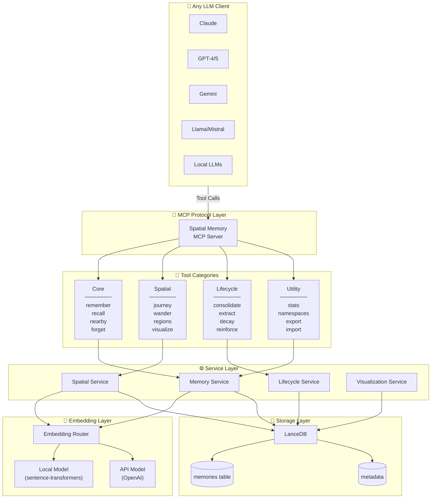

---

## 2. Tool Ecosystem

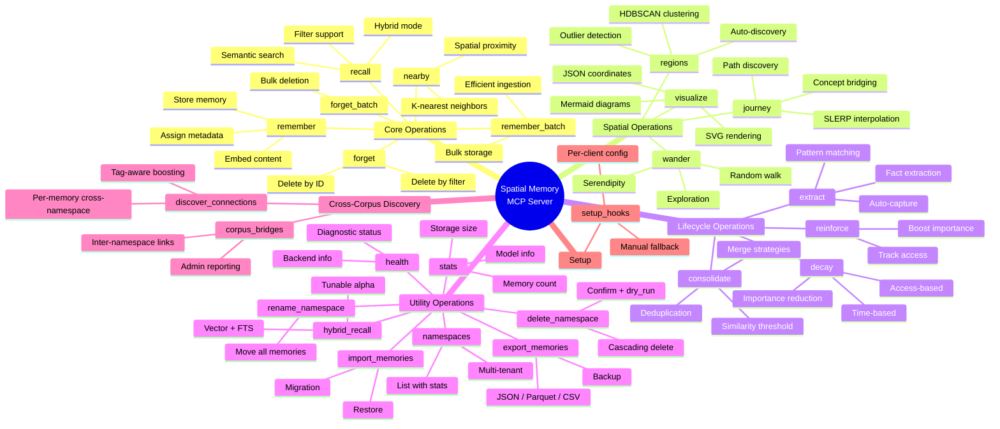

---

## 3. Data Flow — Remember Operation

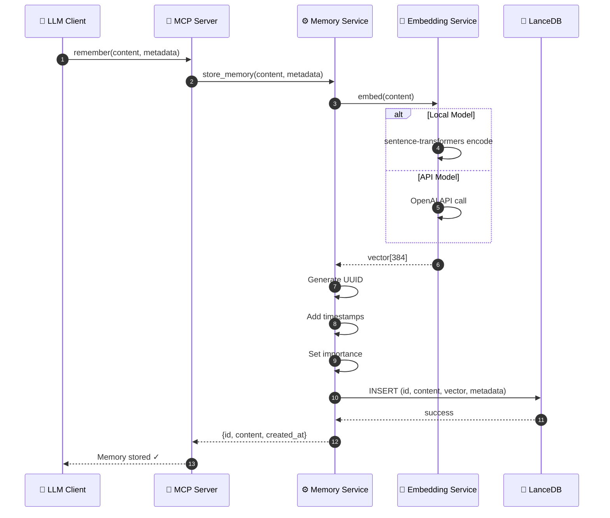

---

## 4. Data Flow — Recall Operation

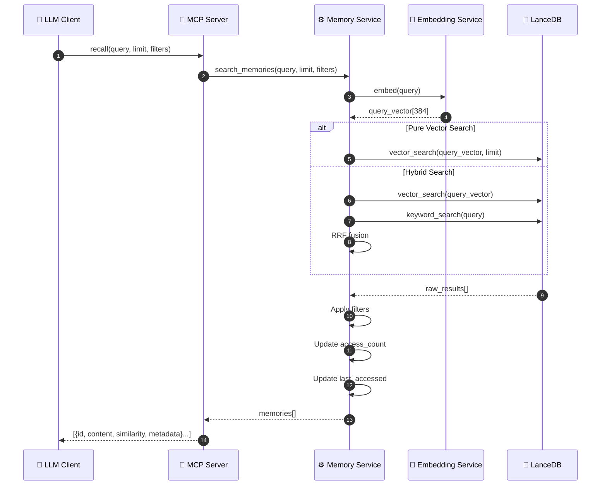

---

## 5. Data Flow — Journey Operation (SLERP)

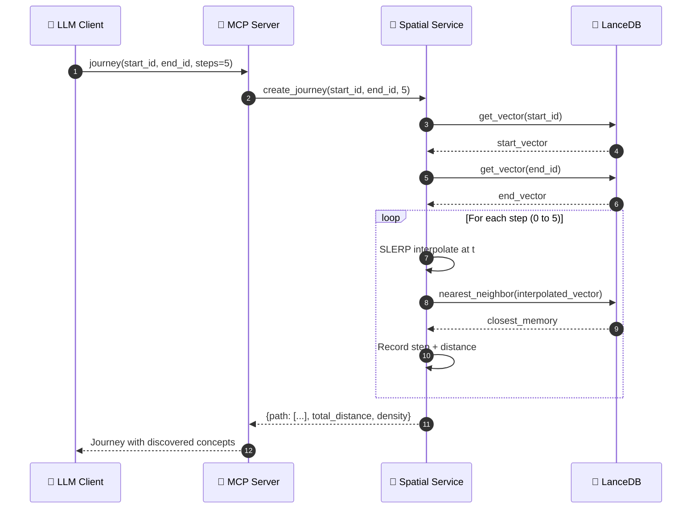

---

## 6. Data Flow — Regions Operation (Clustering)

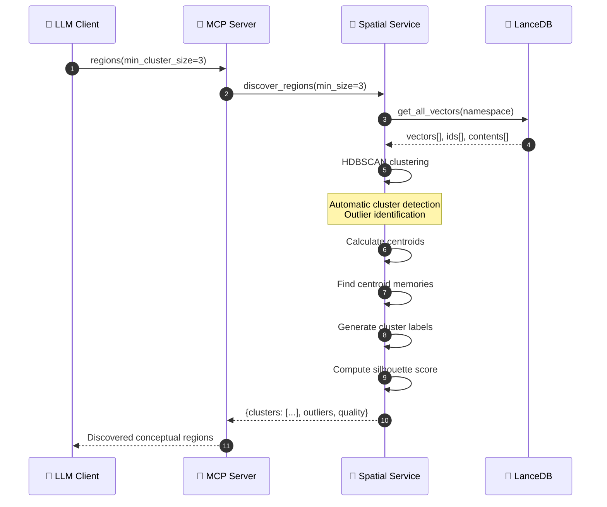

---

## 7. Module Structure

```mermaid
flowchart TB
    subgraph Package["📦 spatial_memory"]
        Main["__main__.py<br/>Entry Point"]
        Server["server.py<br/>MCP Server"]
        Config["config.py<br/>Settings"]
        
        subgraph Core["core/"]
            Database["database.py<br/>LanceDB Wrapper"]
            Embeddings["embeddings.py<br/>Embedding Router"]
            Models["models.py<br/>Pydantic Models"]
            Errors["errors.py<br/>Exceptions"]
        end
        
        subgraph Services["services/"]
            MemorySvc["memory.py<br/>CRUD Operations"]
            SpatialSvc["spatial.py<br/>Journey/Wander/Regions"]
            LifecycleSvc["lifecycle.py<br/>Consolidate/Extract/Decay"]
            VizSvc["visualization.py<br/>JSON/Mermaid/SVG"]
        end
        
        subgraph ToolDefs["tools/"]
            CoreTools["core_tools.py"]
            SpatialTools["spatial_tools.py"]
            LifecycleTools["lifecycle_tools.py"]
            UtilityTools["utility_tools.py"]
        end
    end
    
    Main --> Server
    Server --> Config
    Server --> ToolDefs
    ToolDefs --> Services
    Services --> Core
    Core --> Config
```

---

## 8. Memory Data Model

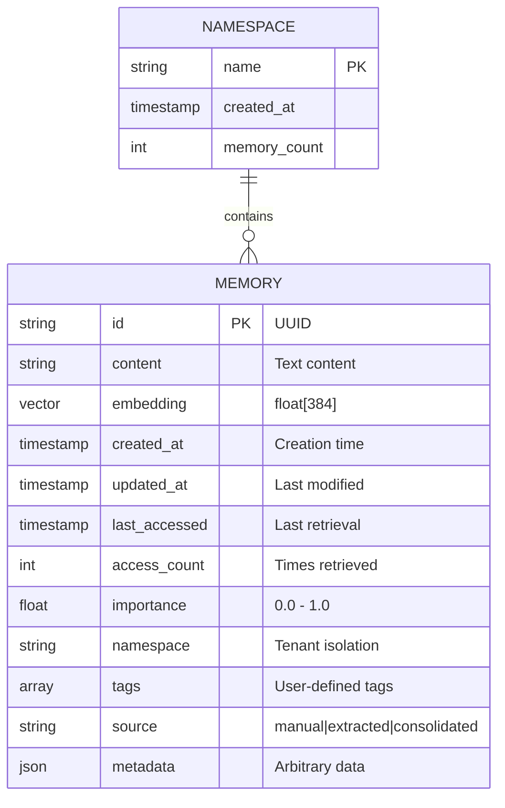

---

## 9. Embedding Resolution (v2.0 — registry-of-one)

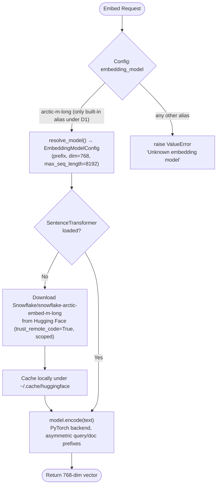

> v2.0 removed the hosted OpenAI provider and all legacy aliases (`all-MiniLM-L6-v2`,
> `all-mpnet-base-v2`, `openai:*`) per decision D1. Pin `spatial-memory-mcp<2.0.0`
> if a hosted embedder is required.

---

## 10. Lifecycle — Decay Algorithm

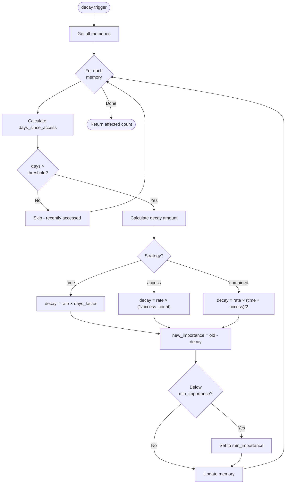

---

## 11. Visualization Output Formats

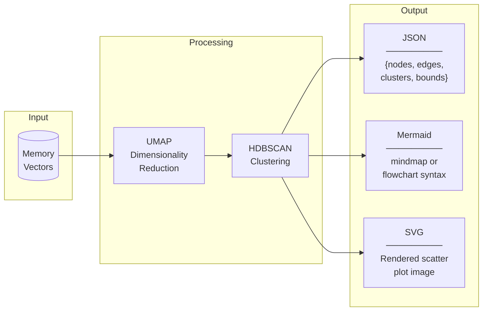

---

## 12. Comparison: Official MCP Memory vs Ours

```mermaid
flowchart TB
    subgraph Official["Official MCP Memory Server"]
        direction TB
        OModel["Knowledge Graph Model"]
        OStore["JSONL File Storage"]
        OSearch["Keyword Search"]
        OTools["9 Tools:<br/>create_entities, create_relations,<br/>add_observations, delete_*, read_graph,<br/>search_nodes, open_nodes"]
    end
    
    subgraph Ours["Spatial Memory MCP Server"]
        direction TB
        SModel["Vector Space Model"]
        SStore["LanceDB Storage"]
        SSearch["Semantic + Hybrid Search"]
        STools["25 Tools:<br/>Core (6) + Spatial (4) +<br/>Lifecycle (4) + Hybrid Search (1) +<br/>Namespace Mgmt (3) + Cross-App (2) +<br/>Data Portability (2) + Admin (3)"]
        SExtra["+ Visualization<br/>+ Auto-clustering<br/>+ Path interpolation<br/>+ Memory dynamics"]
    end
    
    Official -.->|"Finds"| Keyword["Exact keyword<br/>matches only"]
    Ours -.->|"Finds"| Semantic["Semantically related<br/>concepts"]
    
    style Ours fill:#1a4d1a
    style SExtra fill:#2d5a2d
```

---

## 13. Integration with RLM Pattern

```mermaid
flowchart TB
    subgraph RLM["RLM Orchestrator (Parent LLM)"]
        Root["Root LLM<br/>(Clean Context)"]
        REPL["Python REPL<br/>Environment"]
    end
    
    subgraph SubCalls["Sub-LLM Sandboxes"]
        Sub1["Sub-LLM 1"]
        Sub2["Sub-LLM 2"]
        Sub3["Sub-LLM N"]
    end
    
    subgraph Memory["Spatial Memory MCP"]
        Recall["recall()"]
        Journey["journey()"]
        Regions["regions()"]
        Viz["visualize()"]
    end
    
    Root --> REPL
    REPL -->|"Spawns"| Sub1 & Sub2 & Sub3
    
    Root -->|"Direct tool use"| Memory
    Sub1 & Sub2 & Sub3 -->|"Query memory"| Memory
    
    Memory -->|"Concise results"| REPL
    Sub1 & Sub2 & Sub3 -->|"Summaries"| REPL
    REPL -->|"Aggregated answer"| Root
    
    style Memory fill:#1a3d5c
```

---

## 14. Development Timeline

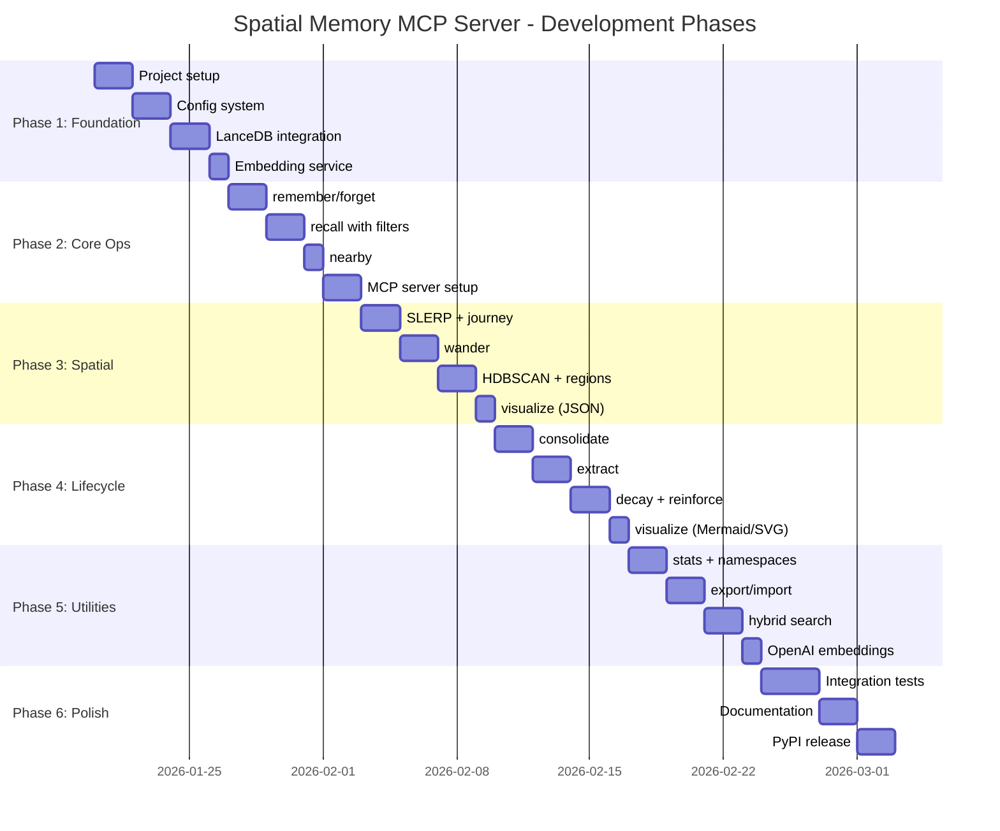

---

*Generated for Spatial Memory MCP Server v2.0.0 — diagrams partially reflect v1.x architecture; see top-of-file warning.*
